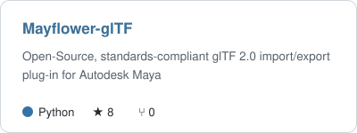
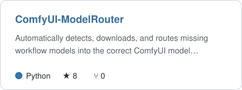
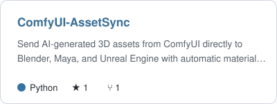
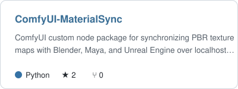
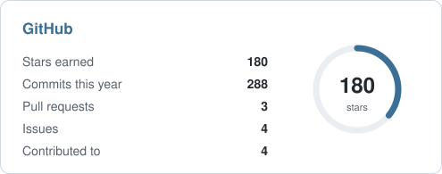
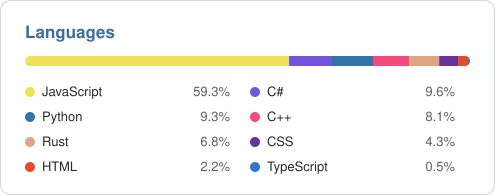

<a href="https://github.com/jaisurya-dev-art">
  <picture><source media="(prefers-color-scheme: dark)" srcset="assets/banner-dark.svg"></picture>
</a>

      

I'm a technical artist and AI pipeline engineer in Bengaluru. For four years I've built the tools that keep game art moving:
Python pipelines, exporters and validators for **EA SPORTS FC 25 & 26, NBA 2K25 & 2K26 and College Football 26**. Outside work
I build open-source tools where 3D, 2D and generative AI meet.

<table>
  <tr>
    <td width="33%" valign="top">
      <h3>3D & DCC pipelines</h3>
      Maya and Blender tooling, glTF, asset QC and batch export, engine integration for Frostbite and Unreal.
    </td>
    <td width="33%" valign="top">
      <h3>Generative AI</h3>
      ComfyUI workflows and custom nodes, Stable Diffusion and FLUX, TRELLIS image-to-3D, local LLMs and MCP servers.
    </td>
    <td width="33%" valign="top">
      <h3>2D animation</h3>
      Rigby2D: an animation editor with runtimes for eight engines, an MCP server for AI assistants, and its interface in English and Chinese.
    </td>
  </tr>
</table>

## Rigby2D

     

**Free, open-source 2D skeletal animation.** Animate a character once and it plays frame for frame in Godot, Unity, Defold,
Cocos Creator, Phaser, PixiJS, the web and Rust, with no runtime fees. AutoRig turns a layered PSD into a rig, DragonBones and Spine files
open as they are, and lip-sync, physics and video rendering are built in.

  
  
  
  
  
  
  
  

  <a href="https://rigby2d.com/editor/"><b>Open the editor in your browser</b></a> &nbsp;·&nbsp;
  <a href="https://github.com/jaisurya-dev-art/rigby2d/releases/latest"><b>Download</b></a> &nbsp;·&nbsp;
  <a href="https://rigby2d.com/docs/"><b>Docs</b></a> &nbsp;·&nbsp;
  <a href="https://rigby2d.com/blog/"><b>Devlog</b></a> &nbsp;·&nbsp;
  <a href="https://discord.gg/PGgaTwbNH"><b>Discord</b></a> &nbsp;·&nbsp;
  <a href="https://github.com/jaisurya-dev-art/rigby2d"><b>Source</b></a>

## Open-source tools

  <a href="https://github.com/jaisurya-dev-art/Mayflower-glTF"><picture><source media="(prefers-color-scheme: dark)" srcset="https://raw.githubusercontent.com/jaisurya-dev-art/jaisurya-dev-art/output/pin-Mayflower-glTF-dark.svg"></picture></a>
  <a href="https://github.com/jaisurya-dev-art/ComfyUI-ModelRouter"><picture><source media="(prefers-color-scheme: dark)" srcset="https://raw.githubusercontent.com/jaisurya-dev-art/jaisurya-dev-art/output/pin-ComfyUI-ModelRouter-dark.svg"></picture></a>
  <a href="https://github.com/jaisurya-dev-art/ComfyUI-AssetSync"><picture><source media="(prefers-color-scheme: dark)" srcset="https://raw.githubusercontent.com/jaisurya-dev-art/jaisurya-dev-art/output/pin-ComfyUI-AssetSync-dark.svg"></picture></a>
  <a href="https://github.com/jaisurya-dev-art/ComfyUI-MaterialSync"><picture><source media="(prefers-color-scheme: dark)" srcset="https://raw.githubusercontent.com/jaisurya-dev-art/jaisurya-dev-art/output/pin-ComfyUI-MaterialSync-dark.svg"></picture></a>

Also: [**ComfyUI-SVG-Rasterizer**](https://github.com/jaisurya-dev-art/ComfyUI-SVG-Rasterizer), SVG to high-resolution image and mask tensors in ComfyUI.

## Stack

   
   
  

Plus ComfyUI, Stable Diffusion, FLUX, TRELLIS, Ollama, Hugging Face, MotionBuilder, Substance Painter, Perforce and Frostbite.

## Activity

  <picture><source media="(prefers-color-scheme: dark)" srcset="https://raw.githubusercontent.com/jaisurya-dev-art/jaisurya-dev-art/output/stats-dark.svg"></picture>
  <picture><source media="(prefers-color-scheme: dark)" srcset="https://raw.githubusercontent.com/jaisurya-dev-art/jaisurya-dev-art/output/langs-dark.svg"></picture>

  <picture><source media="(prefers-color-scheme: dark)" srcset="https://streak-stats.demolab.com/?user=jaisurya-dev-art&hide_border=true&background=0d1117&ring=7ba7c7&fire=7ba7c7&currStreakLabel=7ba7c7&sideLabels=c9d1d9&currStreakNum=f4f4f5&sideNums=f4f4f5&dates=8b949e&stroke=30363d"></picture>

  <picture><source media="(prefers-color-scheme: dark)" srcset="https://raw.githubusercontent.com/jaisurya-dev-art/jaisurya-dev-art/output/snake-dark.svg"></picture>

  

